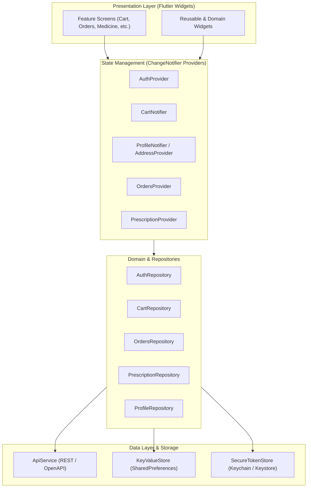
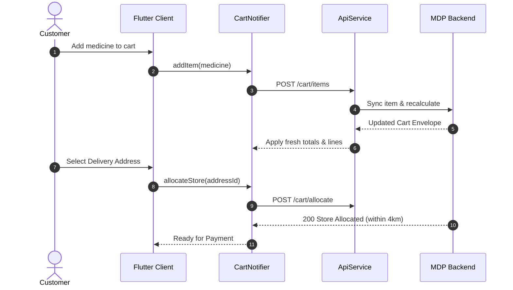

# PharmaCustomer Mobile App (`pharmacustomer_app`)

[](https://flutter.dev)
[](https://dart.dev)
[](https://flutter.dev)
[](https://dart.dev/tools/analysis)

A high-performance, customer-facing mobile application for hyperlocal digital pharmacy services. Built with Flutter, this app supports end-to-end customer workflows: OTC and prescription medicine ordering, digital prescription uploads (camera, gallery, PDF), 4km radius hyperlocal store inventory allocation, secure address management, integrated payments, and real-time order tracking.

---

## 1. Architecture & Engineering Overview

The application follows a **Feature-First Layered Architecture** powered by the **Provider / ChangeNotifier** pattern. It separates UI rendering from business logic and data persistence, emphasizing testability, predictable state updates, and an offline-tolerant hydration lifecycle.



### Core Design Principles
1. **Feature-First Organization**: Each business domain (`cart`, `auth`, `prescriptions`, `orders`, `profile`, `medicine`) owns its models, screens, providers, and repositories.
2. **Predictable Hydration Lifecycle**: App bootstrap (`AppDependencies.bootstrap()`) restores authenticated sessions, pre-loads user/guest carts, and hydrates cached profiles with bounded timeouts before rendering the main dashboard.
3. **Guest-to-User State Promotion**: Users can browse catalogues and build a cart as guests. Upon OTP verification, the local guest cart automatically synchronizes and merges with the server cart.
4. **Lean Implementation (YAGNI)**: Code complexity is kept minimal. No speculative multi-layer interfaces where concrete implementations suffice, no unused dependencies, and zero analyzer warnings.

---

## 2. Tech Stack & Technical Decisions

| Category | Technology | Rationale |
| :--- | :--- | :--- |
| **Framework** | **Flutter (Material 3)** | Cross-platform UI with native performance on Android and iOS. Uses Google Fonts (Plus Jakarta Sans). |
| **Language** | **Dart 3.12+** | Leverages modern Dart features: records, pattern matching, switch expressions, and wildcard parameters (`_`). |
| **State Management** | **Provider (`provider: ^6.1.2`)** | Lightweight, predictable dependency injection and state distribution without the boilerplate of bloated state machines. |
| **Networking** | **`http: ^1.6.0` via `ApiService`** | Centralized REST client with automatic JWT token attachment, structured JSON parsing, and domain error handling (`Failures`). |
| **Secure Storage** | **`flutter_secure_storage: ^10.3.4`** | Hardware-backed session storage: iOS Keychain and Android Keystore for JWT tokens and sensitive session credentials. |
| **Local Cache** | **`shared_preferences: ^2.5.6`** | Asynchronous key-value store for app settings, customer preferences, and guest cart state. |
| **Geo & Location** | **`google_maps_flutter`, `geolocator`, `geocoding`** | Interactive courier route tracking and pin-accurate delivery address resolution. |
| **Document Ingestion** | **`image_picker`, `file_picker`, `pdf`, `printing`** | Seamless multi-page prescription handling from camera, photo gallery, or PDF files. |

---

## 3. Directory Structure

```text
lib/
├── app/
│   └── app.dart                 # Root MaterialApp, AppTheme, and accessibility textScaler bounds
├── core/
│   ├── constants/               # API endpoints (ApiConstants) and configuration
│   ├── errors/                  # Typed domain exceptions (NetworkFailure, ValidationFailure)
│   ├── logging/                 # Concrete AppLogger / ConsoleLogger
│   ├── models/                  # Shared cross-domain models (Medicine, CartItem, Category)
│   ├── providers/               # Cross-cutting providers (CartNotifier, ProfileNotifier)
│   ├── services/                # ApiService: centralized HTTP client & interceptors
│   ├── storage/                 # KeyValueStore, SharedPreferencesStore, SecureTokenStore
│   ├── theme.dart               # Material 3 light theme, color schemes, elevation tokens
│   ├── utils/                   # Pincode validator, coordinate resolvers
│   └── widgets/                 # Reusable UI widgets (SectionHeader, etc.)
├── features/
│   ├── auth/                    # Phone OTP authentication, session restoration, models
│   ├── cart/                    # Cart screen, checkout, address selector, payment processing, live tracking
│   ├── category/                # Category listing and category-specific medicine browsing
│   ├── home/                    # Main navigation wrapper, search bar, home dashboard
│   ├── medicine/                # Medicine details, salt compositions, substitutes
│   ├── onboarding/              # Splash screen and first-time profile setup
│   ├── orders/                  # Order history, timeline details, invoice downloads
│   ├── prescriptions/           # Prescription upload sheet, prescription vault, review flow
│   └── profile/                 # Customer addresses, saved patient profiles/dependents
└── main.dart                    # App entrypoint, dependency bootstrap, provider tree injection
```

---

## 4. Key Subsystems & Workflows

### 4.1. Authentication & Session Lifecycle
- **Flow**: Phone number input -> 6-digit OTP dispatch (`/customers/auth/send-otp`) -> OTP verification (`/customers/auth/verify-otp`) -> Secure session token storage.
- **Bootstrap Hydration**: On application launch, `AppDependencies.bootstrap()` retrieves the active token from `SecureTokenStore`. If valid, it hydrates the user profile and loads the active remote cart. If expired or absent, the app falls back to guest mode.

### 4.2. Hyperlocal Cart & 4km Store Allocation
- **Store Allocation Engine**: To guarantee 10-20 minute express deliveries, the backend assigns a fulfillment pharmacy store within a 4km geofenced radius.
- When an address is selected, `CartNotifier.allocateStore(addressId)` sends the delivery coordinates to `/cart/allocate`.
- If a medicine is out of stock in the nearest hub, the cart updates with actionable warnings before payment checkout.



### 4.3. Digital Prescription Upload & Pharmacist Verification
- **Multi-Format Ingestion**: Supports direct camera capture, gallery selection, and multi-page PDF documents.
- **Review Pipeline**: Prescriptions are uploaded via `MultipartRequest` (`/prescriptions`).
- Uploaded prescriptions link directly to Rx-restricted medicines in the cart. Once submitted, orders reflect clear status badges (`Under Review`, `Approved`, `Clarification Required`).

### 4.4. Order Placement & Live Tracking
- Orders transition through well-defined domain stages: `CREATED` -> `CONFIRMED` -> `PACKED` -> `OUT_FOR_DELIVERY` -> `DELIVERED`.
- Active deliveries render live GPS tracking using Google Maps with route polylines and estimated time of arrival (ETA).

---

## 5. Security & Accessibility

- **Secure Credential Storage**: JWT tokens and customer identification values are never kept in plaintext shared preferences. They are committed strictly to platform-native secure enclaves via `FlutterSecureStorage`.
- **Text Scale Clamping**: To preserve layout integrity while respecting user accessibility settings, global font scaling is safely clamped between `0.85x` and `1.15x` in [app.dart](lib/app/app.dart).
- **Graceful Error Sanitization**: User-facing SnackBars and error alerts strip internal system exceptions (`ValidationFailure: `, `NetworkFailure: `) to present clean, readable messages.

---

## 6. Testing Strategy

The repository includes comprehensive unit and integration tests under `test/`:

```bash
test/
├── api_integration_test.dart       # Contract tests for backend OpenAPI endpoints
├── auth_test.dart                  # Session storage, OTP payload validation, token decoding
├── cart_api_integration_test.dart  # Cart pricing, tax calculation, remote sync
├── cart_persistence_test.dart      # Local guest cart caching and merge policies
├── customer_address_test.dart      # Address model serialization, GeoJSON conversion
└── prescription_test.dart          # Prescription validation and payload construction
```

To run all tests:
```bash
flutter test
```

---

## 7. Developer Setup & Getting Started

### Prerequisites
- **Flutter SDK**: `^3.x` (Channel stable)
- **Dart SDK**: `^3.12.2`
- **Xcode** (for iOS simulator/devices, macOS only)
- **Android Studio / Android SDK** (for Android emulator/devices)
- **CocoaPods** (for iOS native pods)

### Quick Start
1. **Clone the repository**:
   ```bash
   git clone <repository-url>
   cd pharmacustomer_app
   ```

2. **Install dependencies**:
   ```bash
   flutter pub get
   ```

3. **Verify Static Analysis**:
   ```bash
   flutter analyze
   ```
   *(Ensure 0 errors and 0 warnings).*

4. **Run the Application**:
   ```bash
   # Run on default connected device/emulator
   flutter run

   # Run on a specific device
   flutter run -d chrome
   flutter run -d ios
   flutter run -d android
   ```

### API Configuration
The base URL is configured in [lib/core/constants/api_constants.dart](lib/core/constants/api_constants.dart):
```dart
abstract final class ApiConstants {
  static const String baseUrl = 'https://mdp-mvp.onrender.com/api/v1';
  ...
}
```
For local backend development or staging environments, update `baseUrl` or supply environment variables as needed.

---

## 8. Code Quality & Maintenance

This repository undergoes continuous architectural reviews to eliminate dead code, over-engineering, and unnecessary abstractions:
- **Zero Static Analysis Warnings**: Strict adherence to `flutter_lints`.
- **Unified Domain Models**: No duplicated domain models or redundant conversions between UI and persistence layers.
- **Dependency Hygiene**: Kept free of redundant or obsolete third-party packages.
